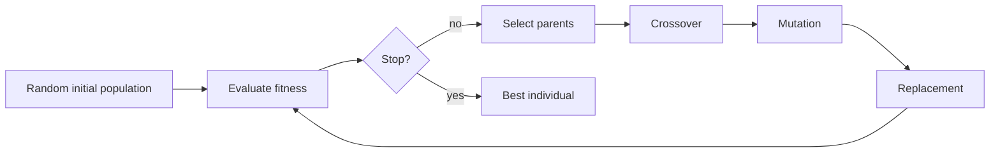

# Concepts

A genetic algorithm (GA) is a search method inspired by natural evolution. Instead of building a solution step
by step, it keeps a *population* of candidate solutions and improves it over many *generations*, by favouring
the better ones and combining and perturbing them.

## Vocabulary

Individual
:   One candidate solution. In GALib, an [`Individual`](reference/core.md#carmelolg.galib.core.individual.Individual)
    holds a *genome* and its fitness.

Genome and gene
:   The genome is the representation of a solution (a string, a list of bits, a tour, a vector of numbers).
    A gene is one of its components. `L` is the genome length, the number of genes.

Fitness
:   A number saying how good an individual is. It is the only thing the algorithm knows about your problem.

Population
:   The set of individuals alive at a given time, of fixed size `N` (`population_size`).

Generation
:   One full cycle of the loop below. Generation 0 is the random initial population.

## The loop

1. **Initialisation**: create `N` random individuals.
2. **Evaluation**: compute the fitness of each one.
3. **Selection**: choose the parents. Better individuals are more likely to be chosen, but weaker ones keep a
   chance: this preserves variety.
4. **Crossover**: combine two parents into two children, hoping that good parts of different solutions add up.
5. **Mutation**: change a few random genes of the children, with a low probability per gene. It brings in
   novelty that crossover alone cannot create.
6. **Replacement**: decide who forms the next generation.
7. **Stop** when the solution is found, when nothing improves any more, or after a maximum number of
   generations.

## Exploitation and exploration

A GA balances two forces:

- **exploitation**: selection and crossover push towards the best solutions found so far;
- **exploration**: mutation and diversity keep searching elsewhere.

Too much exploitation and the population becomes uniform too early, stuck on a mediocre solution: this is
**premature convergence**. Too much exploration and the search is little more than random.

| Parameter        | More exploitation | More exploration |
|------------------|-------------------|------------------|
| Tournament size  | larger            | smaller          |
| Mutation rate    | lower             | higher           |
| Elite size       | larger            | smaller          |
| Population size  | smaller           | larger           |

## Mutation rate

GALib uses a probability **per gene**: each gene mutates independently with probability `mutation_rate`, so a
child gets on average `L × mutation_rate` mutations, sometimes 0, sometimes 2 or more. The default
`1 / L` gives about one mutation per child whatever the genome length; the occasional larger jump helps to leave
local optima.

## Elitism

Elitism copies the best `elite_size` individuals unchanged into the next generation. The best solution found can
then never be lost through an unlucky crossover or mutation, so the best fitness never gets worse from one
generation to the next. One or two elites out of a hundred give this guarantee without reducing diversity much;
too many make the population uniform quickly. GALib keeps 2 by default.

## Diversity

Diversity measures how different the individuals are from each other. With the default measure,
[`positional_diversity`](reference/metrics-plot.md#carmelolg.galib.metrics.positional_diversity), for each gene
position GALib takes the share of individuals that do *not* carry the most common gene, and averages over the
positions:

- close to **1**: very varied population (typical of the random start);
- close to **0**: almost everyone is a copy of the same individual.

Read it together with the fitness:

- best fitness rising while diversity slowly decreases: the search is healthy;
- diversity near 0 while the best fitness is still far from the goal: premature convergence. Raise the mutation
  rate, lower the tournament size or enlarge the population;
- diversity near 0 with the goal reached: the population converged on the right solution.

For real-valued genes, equality makes little sense: use
[`gene_spread`](reference/metrics-plot.md#carmelolg.galib.metrics.gene_spread) (standard deviation of each gene).

## Seed

Computers generate pseudo-random numbers: an algorithm produces a sequence that looks random but is fully
determined by its starting number, the **seed**. With `seed=42` a run is exactly repeatable: same generations,
same individuals, same result. A fixed seed lets you debug a run, write tests that do not flake and compare settings fairly.

One run with one seed says little, because you may have been lucky: to judge a configuration, run it with several
seeds and look at the average. In GALib each run has its own random generator, so two runs in the same program
never influence each other. In your `Problem`, always use the `rng` you receive, otherwise that part stays random
even with a fixed seed.
