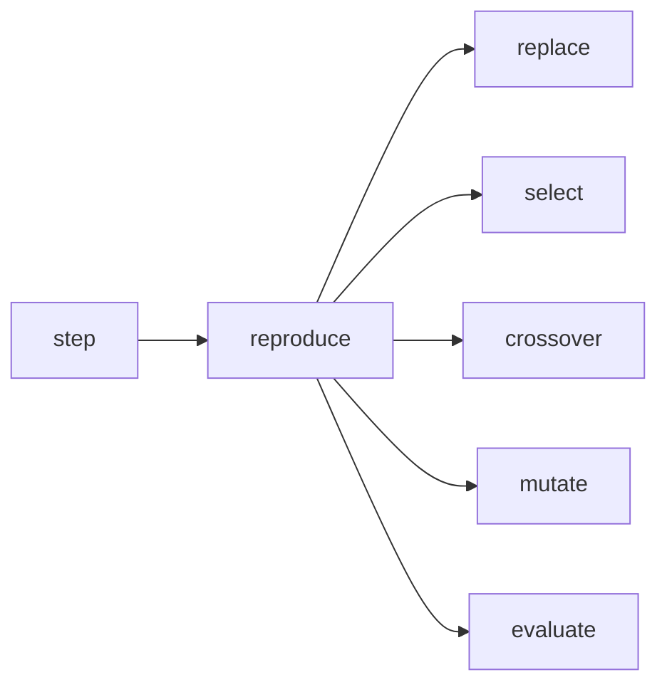

# The engine

[`GeneticAlgorithm`](../reference/core.md#carmelolg.galib.core.engine.GeneticAlgorithm) runs the evolutionary
loop. It can be customised at three levels, from light to deep.

## Level 1: parameters

```python
GeneticAlgorithm(
    problem,
    population_size=100,     # individuals per generation
    max_generations=1000,    # upper bound on evolved generations
    elite_size=2,            # best parents copied unchanged into the next generation
    crossover_rate=0.9,      # probability that a pair of parents is crossed over
    mutation_rate=None,      # per-gene probability; None = 1 / genome length
    stop=[...],              # extra stop conditions
    callbacks=[...],         # hooks called during the run
    seed=None,               # same seed, same run
    executor=None,           # concurrent.futures executor for parallel fitness
    diversity=positional_diversity,  # diversity measure, or None to skip it
)
```

All parameters are validated when the engine is created: for example `elite_size` must be smaller than
`population_size` and rates must lie in `[0, 1]`.

## Level 2: operators

Pass `selection=`, `crossover=` and `mutation=`, or override `crossover` and `mutate` on the problem.
See [Operators](operators.md).

## Level 3: subclassing

`step()` is a *template method* built from small, overridable pieces:



| Method                                    | Default behaviour                                                       |
|-------------------------------------------|-------------------------------------------------------------------------|
| `initial_population()`                    | `population_size` random genomes, evaluated                             |
| `evaluate(genomes)`                       | `problem.fitness_batch`, or `problem.fitness` through the executor      |
| `select(population, count)`               | the selection operator                                                  |
| `crossover(a, b)` / `mutate(genome)`      | the crossover and mutation operators                                    |
| `reproduce(population)`                   | `population_size - elite_size` children                                 |
| `replace(population, offspring)`          | the `elite_size` best parents plus all the children                     |
| `measure_diversity(population)`           | the `diversity` measure                                                 |
| `collect_stats()`                         | builds the `GenerationStats` of the current generation                  |

For example, a (μ + λ) strategy where parents and children compete for survival:

```python
class MuPlusLambda(GeneticAlgorithm):
    def replace(self, population, offspring):
        both = sorted([*population, *offspring], key=lambda i: i.score, reverse=True)
        return both[: self.population_size]


MuPlusLambda(problem, elite_size=0).run()  # every parent already competes
```

The engine never relies on the population being sorted, so `replace` may return individuals in any order.

## Driving the loop yourself

`run()` is `initialize()` followed by `step()` until a stop condition fires. You can do the same by hand:

```python
engine = GeneticAlgorithm(problem, seed=1)
engine.initialize()  # generation 0
while engine.best.fitness < 10:
    engine.step()
print(engine.generation, engine.best.genome)
```

## Reproducibility

Each run creates its own `random.Random(seed)`; calling `run()` again restarts from scratch with the same seed.
Operators that use numpy draw from a numpy generator derived from that same `Random`, so numpy runs are
reproducible too.

## Results

`run()` returns a [`Result`](../reference/core.md#carmelolg.galib.core.stats.Result):

| Attribute     | Content                                                                          |
|---------------|----------------------------------------------------------------------------------|
| `best`        | the best `Individual` ever seen (genome, fitness, score)                         |
| `generations` | evolved generations                                                              |
| `stopped_by`  | `"max_generations"` or the class name of the stop condition that fired           |
| `evaluations` | number of fitness evaluations (elites are never evaluated twice)                 |
| `history`     | one `GenerationStats` per generation, generation 0 included                      |
| `population`  | the final population                                                             |
